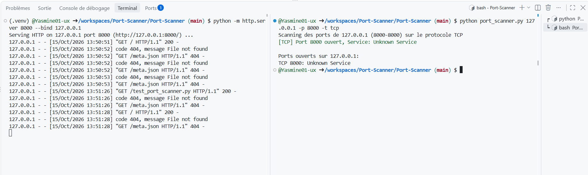
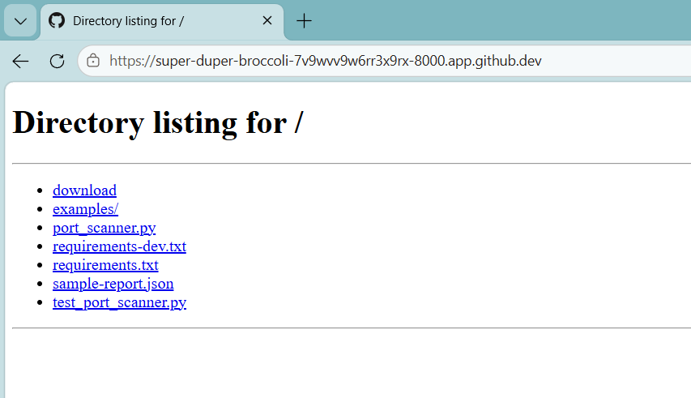

# Port Scanner — Scanner de ports TCP/UDP

Outil pédagogique développé en **Python** permettant d’analyser les ports TCP et UDP d’une cible autorisée, d’identifier les services courants et d’exporter les résultats au format JSON.

Ce projet met en pratique des concepts fondamentaux de la sécurité réseau : analyse des ports, observation des réponses réseau et interprétation des états détectés. Il s’inspire de fonctionnalités de base des scanners réseau sans remplacer des outils spécialisés tels que Nmap.

## Fonctionnalités

- **Scan TCP Connect** : vérification de l’accessibilité des ports par connexion TCP.
- **Scan TCP SYN et ACK** : méthodes d’analyse réseau utilisant Scapy.
- **Scan UDP** : analyse des ports UDP avec Scapy.
- **Sélection des ports** : port individuel, liste ou plage de ports.
- **Identification indicative des services** : association des numéros de ports aux services courants.
- **Estimation du système d’exploitation** : indication approximative basée sur le TTL ICMP.
- **Affichage des résultats** : présentation des informations dans le terminal.
- **Export JSON** : sauvegarde des résultats pour une exploitation ultérieure.
- **Tests automatisés** : vérification du comportement du programme avec pytest.

## Technologies utilisées

| Technologie | Utilisation |
|---|---|
| Python 3.10+ | Langage principal |
| Scapy | Analyse et manipulation de paquets réseau |
| Colorama | Coloration des résultats dans le terminal |
| pytest | Tests automatisés |
| JSON | Export des résultats |

## Structure du projet

```text
port-scanner-professionnel/
├── port_scanner.py          # Code principal
├── requirements.txt         # Dépendances d’exécution
├── requirements-dev.txt     # Dépendances de développement et de test
├── test_port_scanner.py     # Tests automatisés
├── sample-report.json       # Exemple de rapport JSON
└── screenshots/
    ├── ResultScan.png       # Résultat du scan dans le terminal
    └── testport.png         # Démonstration d’un port ouvert
```

## Prérequis

- Python 3.10 ou version ultérieure.
- pip pour installer les dépendances.
- Scapy pour les scans UDP, SYN et ACK ainsi que l’estimation du système.
- Des privilèges administrateur ou root pour certaines opérations réseau, selon le système et la méthode utilisée.

## Installation

### Linux / macOS

Depuis le dossier du projet :

```bash
python3 -m venv .venv
source .venv/bin/activate
python -m pip install --upgrade pip
python -m pip install -r requirements.txt
```

### Windows — PowerShell

```powershell
py -m venv .venv
.\.venv\Scripts\Activate.ps1
python -m pip install --upgrade pip
python -m pip install -r requirements.txt
```

## Utilisation

Les commandes suivantes sont des exemples à exécuter uniquement sur une machine ou une cible pour laquelle vous disposez d’une autorisation.

### Afficher l’aide

```bash
python port_scanner.py --help
```

### Scanner une liste de ports TCP

```bash
python port_scanner.py 127.0.0.1 -p "22,80,443" -t tcp
```

### Scanner une plage de ports TCP

```bash
python port_scanner.py 127.0.0.1 -p 20-80 -t tcp
```

### Scanner des ports UDP

```bash
python port_scanner.py 127.0.0.1 -p "53,123,161" -t udp
```

### Exporter les résultats au format JSON

```bash
python port_scanner.py 127.0.0.1 -p "22,80,443" -t tcp --json --output sample-report.json
```

### Utiliser les méthodes SYN et ACK

```bash
python port_scanner.py 127.0.0.1 -p "80,443" -t tcp --scan-method syn
python port_scanner.py 127.0.0.1 -p "80,443" -t tcp --scan-method ack
```

Ces méthodes nécessitent Scapy et peuvent demander des privilèges élevés. Un scan ACK sert principalement à observer le filtrage réseau ; il ne confirme pas à lui seul qu’un port est ouvert.

### Estimer le système d’exploitation

```bash
python port_scanner.py 127.0.0.1 -p 80 -t tcp --os-detect
```

Cette estimation est indicative : le TTL peut varier selon le système, la configuration réseau et les équipements intermédiaires.

## Démonstration

Les captures suivantes illustrent les tests effectués avec le scanner.

### 1. Résultat du scan dans le terminal

Cette capture présente l’affichage des résultats obtenus lors de l’exécution du programme.

<p align="center">
  
</p>

### 2. Vérification d’un port ouvert

Cette capture présente la démonstration d’un port ouvert dans l’environnement de test.

<p align="left">
  
</p>
Les résultats dépendent du service actif, de la cible testée, des règles du pare-feu et de la méthode de scan utilisée.

## Tests automatisés

Pour installer les dépendances de développement et exécuter les tests :

```bash
python -m pip install -r requirements-dev.txt
python -m pytest -q
```

L’exécution de pytest permet de vérifier les fonctionnalités couvertes par les tests automatisés du projet.

## Limites connues

- Un port UDP silencieux peut être ouvert, filtré ou inaccessible ; l’absence de réponse ne signifie pas nécessairement qu’il est fermé.
- L’identification des services repose principalement sur les numéros de ports et ne garantit pas le service réellement exécuté.
- Les scans SYN et ACK dépendent de Scapy, des privilèges disponibles et des règles réseau.
- L’estimation du système d’exploitation à partir du TTL reste approximative.
- Les délais, les règles de filtrage et les conditions réseau peuvent influencer les résultats.
- L’outil est pédagogique et ne garantit pas une détection exhaustive.

## Sécurité et utilisation responsable

Cet outil doit être utilisé uniquement sur vos propres équipements, votre réseau ou des cibles pour lesquelles vous disposez d’une autorisation explicite.

Avant tout test, consultez le document [SECURITY.md](docs/SECURITY.md), s’il est présent dans le dépôt.

## Améliorations possibles

- Ajouter des états de ports plus précis : `open`, `closed`, `filtered` et `unknown`.
- Améliorer la gestion des erreurs et la validation des cibles.
- Ajouter une configuration des délais et du nombre de threads.
- Proposer des exports supplémentaires en CSV ou HTML.
- Mettre en place une intégration continue pour exécuter automatiquement les tests.

## Licence

Distribué sous licence MIT. Consultez le fichier [LICENSE](LICENSE) pour plus d’informations.